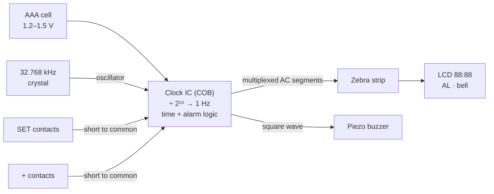
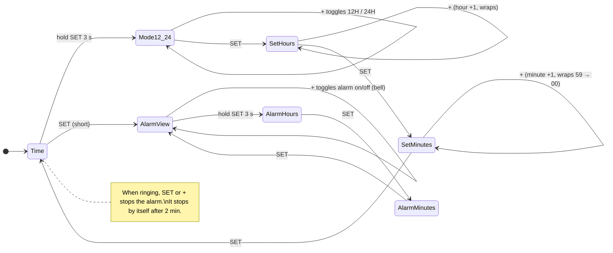
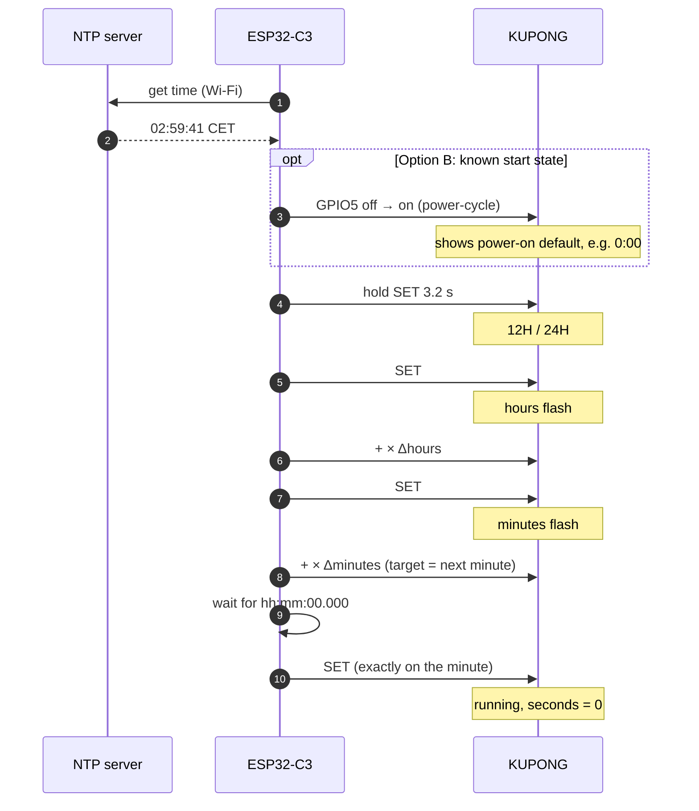

# KUPONG hardware: what's inside and where to modify it

The IKEA **KUPONG** (art. 906.218.11, about €1) is a small **digital LCD alarm clock**: 7 × 6 × 4 cm, one AAA cell, no backlight, two buttons on the back. It keeps time with its own quartz crystal, but it can't set itself.

The plan in this repo is to **leave the clock's electronics in place** and let an ESP32-C3 press its buttons. The ESP32 gets the exact time over Wi-Fi (NTP) and sets the KUPONG the way a person would, only to the second and every day, including summer/winter time.

> [!WARNING]
> **The board drawings are representative, not traced from a real KUPONG.** No public teardown of this clock exists. They show the typical layout of €1 LCD clocks. Work through the [verification checklist](#verify-on-your-board) on your own unit before cutting or soldering, and add photos to `docs/img/` once you have opened one.

## Contents

- [Anatomy](#anatomy)
- [How the original circuit works](#how-the-original-circuit-works)
- [The button menu](#the-button-menu-from-the-ikea-manual)
- [Where to tap](#where-to-tap)
- [Modification wiring](#modification-wiring)
- [How a press is injected](#how-a-press-is-injected)
- [Sync procedure](#sync-procedure)
- [Verify on your board](#verify-on-your-board)
- [Safety and handling](#safety-and-handling)
- [Alternatives considered](#alternatives-considered)

## Anatomy

| Part | What it is | Notes |
|---|---|---|
| **LCD glass** | 4 digits, colon, `AL` and bell icons | Passive LCD, needs no backlight and draws microamps |
| **Zebra strip** | Rubber strip with conductive layers | Presses the LCD contacts onto a row of pads. Don't lose or misalign it when reassembling. |
| **COB** | "Chip on board": the bare clock IC under a black epoxy blob | Counts time, drives the LCD, reads the buttons, beeps the buzzer. Not reprogrammable. |
| **32.768 kHz crystal** | Small metal cylinder | 32 768 = 2¹⁵, so 15 halvings give exactly 1 Hz |
| **SET / + contacts** | Interdigitated pads under rubber or plastic button caps | Pressing a button shorts the two combs together |
| **Battery pads** | BAT+ / BAT− leads from the AAA holder | 1.2–1.5 V |
| **Piezo buzzer** | Brass disc | The alarm sound. It gets louder in 4 steps over 2 min. |

## How the original circuit works

Everything runs at **1.5 V**. Each button input usually has a weak internal pull-up inside the IC. Pressing the button shorts it to the common pad (GND or, less often, VDD). The IC only cares that **the two pads are connected**, so anything that bridges them is a button press. That is the hook for the modification.

## The button menu (from the IKEA manual)

From IKEA manual AA-2261509-2, which uses pictograms only:

Only two inputs, SET and +, are needed to reach every function. Two GPIOs are enough.

## Where to tap

| # | Point | Used for | Required? |
|---|---|---|---|
| **1** | SET contact pair | Optocoupler #1 (collector → signal comb, emitter → common comb) | yes |
| **2** | + contact pair | Optocoupler #2 | yes |
| **3** | BAT+ | ESP-switched 1.5 V supply, to reset the clock to a known state | option B |
| **4** | BAT− (GND) | Common ground with the ESP | option B |
| **5** | Buzzer lead | A third opto or divider into a GPIO to detect "alarm ringing" | optional |

On the comb pads, solder to the **trace leading away from each comb**, or to a via, not onto the comb fingers themselves. The rubber dome still has to sit flat.

## Modification wiring

**Why optocouplers?** The ESP32 runs at 3.3 V and the clock IC at 1.5 V. Driving a 1.5 V input from a 3.3 V pin can damage it through its protection diodes. A PC817 is just an LED and a phototransistor in one package, so the two circuits stay **galvanically isolated**, exactly like a finger pressing a button.

| Part | Value | Why |
|---|---|---|
| R1, R2 | 1 kΩ (470 Ω–1 kΩ) | (3.3 V − 1.2 V) / 1 kΩ ≈ 2 mA LED current. The PC817's CTR ≥ 50 % gives ≥ 1 mA, far more than a µA button pull-up needs. |
| U1, U2 | PC817 (DIP-4 or SMD) | Pin 1 anode, 2 cathode, 3 emitter, 4 collector |
| LDO *(option B)* | 1.5 V, e.g. XC6206P152 + 1 µF caps | Replaces the AAA so the ESP can power-cycle the clock |

The phototransistor conducts in one direction only. **The collector goes to the pad at the higher voltage** (the IC input with its pull-up) and the **emitter to the common pad**. If a press does nothing, swap the two output wires.

**Power, option A (start here):** keep the AAA. Only the two opto outputs are connected and there's no shared ground. The ESP can't reset the clock, so it has to know what the display shows (see [Sync procedure](#sync-procedure)).

**Power, option B:** remove the AAA and feed BAT+ from a 1.5 V regulator powered by GPIO5. A GPIO can source about 20 mA, which should cover the clock including the buzzer. **Measure the buzzer current first**, and use a P-MOSFET switch if it's more. Switching GPIO5 off and on resets the clock to its power-on state, so the ESP always starts from a known display.

## How a press is injected

Each GPIO pulse (about 300 ms; tune it) lights the opto's LED, the transistor conducts, and the clock IC sees a button press. A "hold SET 3 s" is simply a 3.2 s pulse.

## Sync procedure

The KUPONG's crystal drifts a few seconds per week. The ESP corrects it once a day, for example at 03:00:00. The final **SET** lands exactly on the minute boundary, which zeroes the clock's seconds (to be verified, see checklist).

**Δ (number of presses)** = target − current, modulo 24 (hours) or 60 (minutes):
- **Option B:** "current" is the known power-on value.
- **Option A:** "current" is what the ESP set last time. That only works after a first manual alignment, and the ESP has to be told when the battery is changed.

At most 23 + 59 presses at ~0.5 s each is under a minute per sync. DST is free: NTP plus the `CET-1CEST,M3.5.0,M10.5.0/3` timezone gives the right local hour, and the next sync applies it. To apply it immediately, trigger a sync at 02:00 / 03:00 on change days.

## Verify on your board

Before wiring anything, open the clock and check these. Then update this document.

- [ ] **Layout:** does the board match the drawing? Take photos and add them as `docs/img/kupong-photo-*.jpg`.
- [ ] **Button pads:** which comb of each button is common? Measure continuity to BAT−. If the common pad goes to BAT+ instead, the opto still works: collector to the higher-voltage pad.
- [ ] **Manual bridge test:** short the SET pads with tweezers. Does the clock react like a real press?
- [ ] **Power-on default:** after inserting the battery, what does it show? 0:00 or 12:00? 12h or 24h mode? Is it the same every time?
- [ ] **Seconds reset:** after the final SET in time setting, does the minute roll over exactly 60 s later? Time it against a phone.
- [ ] **Auto-repeat:** does holding + fast-advance? At what rate? (This could speed up syncing.)
- [ ] **Shortest press:** what's the shortest pulse the IC registers? Is there a debounce or minimum gap between presses?
- [ ] **Current draw:** measure idle and alarm-ringing current at 1.5 V. This decides whether option B can be powered from a GPIO.
- [ ] **Drift:** how many seconds per day does it gain or lose? This decides how often to sync.

## Safety and handling

- **Remove the battery** before soldering.
- **Don't touch the epoxy blob** and don't heat near it for long.
- **The zebra strip and LCD only sit in place, held by pressure.** Note how they go together before you lift the board, and keep them clean.
- **Use thin wire** (30 AWG wire-wrap or enamelled wire) and a low iron temperature. The pads are small and the €1 PCB's copper lifts easily.
- **Use strain relief:** glue the new wires to the board (hot glue or UV glue) so they don't rip the pads off.
- **Don't connect ESP GPIOs directly to the clock IC.** It runs at 3.3 V vs 1.5 V. Always go through the optocouplers.

## Alternatives considered

| Approach | Verdict |
|---|---|
| **Button injection via optocouplers** *(this doc)* | ✅ Keeps the original display, alarm and case. Cheap (2 × PC817). The ESP never needs to read the display. |
| Read the LCD segments and drive the clock closed-loop | ❌ Multiplexed AC segment signals at 1.5 V. Too many wires and too fragile for a €1 clock. |
| Replace all electronics with ESP + own display (OLED / e-paper) in the KUPONG case | 🟡 Full control, but it's then really a new clock in a borrowed case. |
| DCF77 radio module instead of Wi-Fi | 🟡 Possible with the same button injection, using a 77.5 kHz receiver instead of NTP. Needs no Wi-Fi but more parts. |

---

Diagrams: the SVGs are generated by [`img/generate.py`](img/generate.py). Edit the script and run `python3 docs/img/generate.py` to regenerate them.
